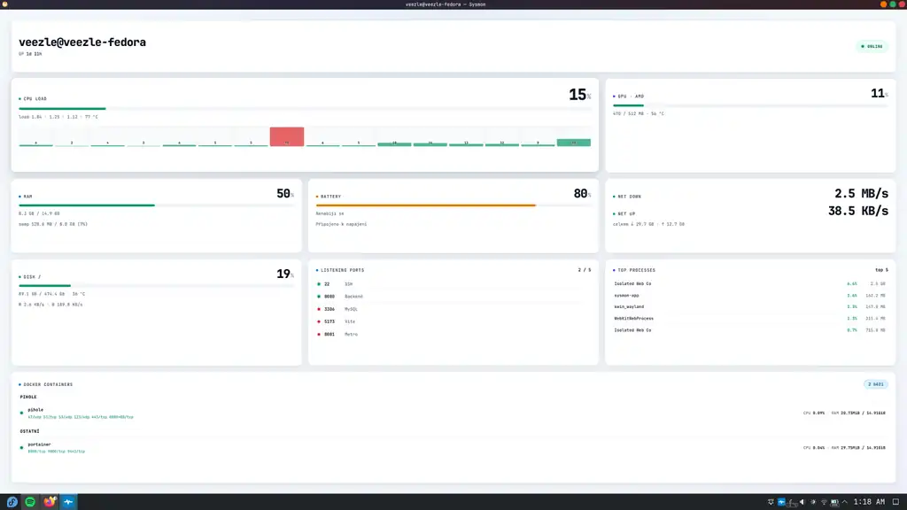

# Sysmon App

A lightweight Linux system monitor with a React dashboard, a native desktop window, and optional access from other devices on the local network.

Sysmon App collects system metrics in one background daemon and displays the same live dashboard in a browser or a Tauri desktop window.

## Screenshot



## Features

- CPU, memory, swap, disk and network usage
- Running processes and system information
- GPU and battery metrics when supported by the system
- Listening ports and selected service status
- Docker container information
- Live updates over Server-Sent Events (SSE), with polling fallback
- Native desktop window with system tray integration
- Optional access from a phone or another device on the local network
- Standalone Linux packages with a bundled daemon

## Architecture

```text
System collectors
       |
       v
Python daemon
       |
       +---- GET /stats
       |
       +---- SSE /events
       |
       v
React dashboard
       |
       +---- Web browser
       |
       +---- Tauri desktop window
```

The daemon collects metrics in a single cycle and keeps the latest snapshot. All dashboard clients use the same data source. The Tauri application is a native wrapper around the dashboard and can manage the bundled daemon.

## Installation

Pre-built packages are available from the project's [GitHub Releases](https://github.com/Veezle/sysmon-app/releases), when published.

| Package | Installation |
|---|---|
| Debian / Ubuntu | `sudo apt install ./sysmon-app_*.deb` |
| Fedora | `sudo dnf install ./sysmon-app-*.rpm` |
| Arch Linux | Build with the supplied PKGBUILD |
| AppImage | Make the file executable and run it |

The Debian and RPM packages use the system WebKitGTK and GTK libraries. The AppImage has separate compatibility requirements because it is built with bundled libraries.

See [Installation](docs/installation.md) for package requirements, supported distributions, and build instructions.

## Run from source

Requirements:

- Python 3.11+
- Node.js 20.19+ or 22.12+
- npm

Build the frontend and start the daemon:

```bash
cd frontend
npm ci
npm run build
cd ..

python3 -m sysmon_app
```

Open the dashboard at:

```text
http://localhost:8430
```

The daemon listens on port `8430` by default. Packaged applications include a bundled daemon and do not require a system-wide Python installation.

## Desktop application

The desktop application uses Tauri 2. It displays the same dashboard as the browser and can start the bundled daemon when needed.

Closing the window hides the application in the system tray. Use the tray menu to reopen the dashboard or exit the application.

## Configuration

Configuration file:

```text
~/.config/sysmon-app/config.toml
```

Example:

```toml
host = "127.0.0.1"
port = 8430
ignored_ports = [53, 631]

[watch_ports]
22 = "SSH"
3306 = "MySQL"
```

The default host is `127.0.0.1`. The dashboard is available only on the local machine.

To access the dashboard from another device on a trusted local network, set `host = "0.0.0.0"`. **The API has no authentication.** Any device that can reach the port can see system metrics, running processes, and listening ports. Do not expose the dashboard to the public Internet.

## Development

Run the daemon in one terminal:

```bash
python3 -m sysmon_app
```

Start the Vite development server in another terminal:

```bash
cd frontend
npm run dev
```

The development server proxies API requests to the daemon on port `8430`.

## Tests

Python tests:

```bash
python3 -m unittest discover -s tests -t .
```

Rust tests:

```bash
cargo test --manifest-path src-tauri/Cargo.toml
```

Frontend type checking:

```bash
cd frontend
npm run typecheck
```

## Documentation

- [Installation and packaging](docs/installation.md)
- [Architecture and API](docs/architecture.md)
- [Development and testing](docs/development.md)

## Related project

Sysmon App is a separate application from the original [Sysmon](https://github.com/Veezle/sysmon) project. Both can run side by side.
